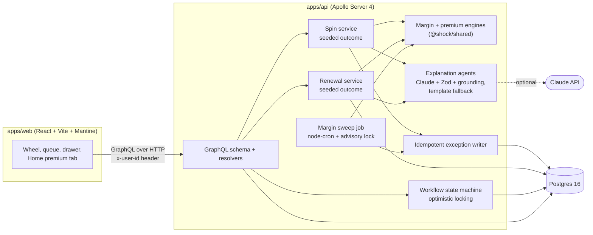

# Shock Wheel

Shock Wheel is an exception queue for a brokerage operations desk, with a twist. Spin the wheel and the server picks a market stress scenario, such as a Strait of Hormuz closure or a surprise 75bp Fed hike, at a random severity. It applies that shock to every seeded portfolio, writes an exception for each account that falls below maintenance margin, and asks an explanation agent to describe what happened: first-order price effects, second-order effects (including insurance and coverage angles), which accounts are at risk, and what the desk should do next. Analysts then work the queue: assign, escalate, resolve, with every step audited. A scheduled margin sweep runs alongside, catching breaches from ordinary price drift.

The same wheel also powers **Renewal roulette**: describe a house, spin, and see how its home insurance premium changes over successive renewal years.

> Prices, positions, shock sizes, hazard scores and premiums are illustrative parameters, not forecasts, market data or quotes.

## Architecture



- **packages/shared**: types, the 8 wheel scenarios, the margin engine, the premium engine (regions, 16 renewal events, `computeRenewal`), and a seeded RNG. Pure functions, no I/O.
- **apps/api**: Prisma schema and seed data, the GraphQL API, the spin and renewal services, the sweep job, the explanation agents, and the workflow.
- **apps/web**: the UI. The server decides every spin result; the browser only animates the wheel to the slice the server returned.

## Quickstart

Needs Node 22+, pnpm 9 and Docker.

```bash
cp .env.example .env
cp .env.example apps/api/.env      # add ANTHROPIC_API_KEY here for Claude explanations

pnpm install
pnpm db:up                          # Postgres 16 in Docker
pnpm db:push                        # create the schema
pnpm db:seed                        # 16 accounts, 21 instruments, users

pnpm dev                            # API on http://localhost:4000, web on http://localhost:5173
```

Apollo Sandbox runs at http://localhost:4000. Switch users from the header; requests carry an `x-user-id` header (default `u-maya`).

Other useful commands:

```bash
pnpm test                           # all unit and integration tests
pnpm typecheck
pnpm --filter @shock/web e2e        # Playwright + axe accessibility checks (needs the DB seeded)
pnpm --filter @shock/api sweep      # run one margin sweep from the CLI
pnpm --filter @shock/api calibrate  # print the seed breach matrix (accounts x scenarios x severities)
pnpm --filter @shock/api renewals   # print sample Renewal roulette paths from the premium engine
pnpm --filter @shock/web build
```

## Renewal roulette

Open the **Home premium** tab. The defaults describe a typical house, so you can spin straight away, or describe your own first: region, rebuild cost, year built, roof age, construction, distance to water, whether it backs onto forest, claims in the last five years, deductible, current premium, and which endorsements you carry (overland flood, sewer backup, earthquake). The form shows your region's hazard scores and your house's exposure, and flags coverage gaps as you edit.

Each spin is one renewal year. The wheel has 16 events:

- **Perils:** hurricane landfall, wildfire season, spring flood, hail storm, polar vortex freeze, sewer backup storm, earthquake swarm, ice storm.
- **Market:** reinsurance costs spike, construction costs jump, insurer exits your region, flood maps redrawn, regulator caps rates.
- **Personal:** new roof installed and claims-free year (both can lower the premium, and show in green on the wheel), and you filed a water damage claim.

After each spin you get the new premium and the change, a waterfall of what moved the price, a non-renewal risk badge, coverage gap callouts, and an explanation: why it moved, what to ask your broker, and mitigation ideas. A path chart tracks the premium across years, each point labelled by the event that caused it. "Spin next year" advances the path; "Start over" returns to the saved house with a fresh path seed.

> **This is an educational model, not advice or a quote.** Real premiums depend on your insurer's rating and policy wording; confirm anything that matters with a licensed broker. Every result in the app carries the line "Illustrative model, not a quote."

### How the premium engine works

`packages/shared/src/premium.ts`, pure and deterministic.

1. **Exposure per peril.** Each region has an illustrative hazard score from 0 to 1 for wind, wildfire, flood, hail, water backup, earthquake and winter freeze. The house modifies those scores: within 500 m of water raises flood (and wind on windy coasts), backing onto forest raises wildfire, a roof over 15 years old raises wind and hail, masonry or concrete lowers wildfire and wind, and a pre-1970 build raises water backup. Each peril is clamped to 0–1.5.
2. **The event.** Peril events push the premium in proportion to your exposure (`shock × severity × exposure`). Market events apply reinsurance pass-through (scaled by catastrophe exposure), construction inflation (which also lifts the rebuild cost), capacity cuts (worse where exposure is high), or a regulator's rate cap. Personal events reset the roof (credited by the wind and hail exposure it removes) or move the claims count, which carries an 8% loading per claim. A 3% annual trend applies every year. Severity (mild 0.5×, severe 1×, tail 2×) scales peril and market effects; personal events apply as-is.
3. **Limits.** A rate cap clamps the increase, every year's change is clamped to −15%…+60%, and the premium never drops below a minimum. Each clamp is its own driver.
4. **Drivers sum exactly to the change.** The arithmetic runs in cents, so the waterfall always adds up to the new premium.
5. **Non-renewal risk** is high when exposure is high and insurers are cutting capacity; medium for very high exposure or three or more claims. **Coverage gaps** flag high flood, water backup or earthquake exposure without the matching endorsement.
6. **Reproducible paths.** Year N spins with seed `<pathSeed>:<N>` through the same `spinOutcome` as the shock wheel, so a house's path seed replays every year exactly. You can also pass your own seed for a year.

The renewal explainer gets only the computed drivers, premiums, exposures and house facts. Its reply goes through the same Zod and numeric grounding checks as the scenario explainer (an invented "save $450 a year" falls back to the template).

## How idempotency works

Exceptions get written from two places, a scheduled sweep and user-triggered spins, and both can retry or overlap. Three mechanisms keep the queue free of duplicates.

1. **Unique `(accountId, dedupeKey)`.** Every exception carries a dedupe key: `sweep:<YYYY-MM-DD>` for the sweep and `run:<scenarioRunId>` for a spin. A unique constraint on `(accountId, dedupeKey)` means re-running the same sweep on the same day, or replaying the same run's write, can't create a second row. The writer skips rows it has already seen. If two writers race, the loser gets a unique violation (Prisma `P2002`), which is caught and counted as skipped.
2. **Postgres advisory lock for the sweep.** The sweep takes `pg_try_advisory_xact_lock` inside a short interactive transaction. If another API instance already holds it, the sweep returns `skippedLocked: true` instead of waiting, so you can run several API instances without double sweeps. The lock is transaction-scoped on purpose: a session lock taken and released through a connection pool can be "released" on a different connection, which leaves it held and silently blocks every later sweep. A regression test checks that no advisory lock survives overlapping sweeps.
3. **Seeded replay.** A spin's scenario, severity and price moves all derive from its seed. Passing the same seed to `spinWheel(seed:)` reproduces the run exactly: same slice, same breaches, same deficits. Runs are easy to audit and bugs are easy to reproduce.

Workflow changes (assign, escalate, resolve) use optimistic locking. The update is conditional on the status the server just read, so when two analysts act at once only one wins. The other gets a `CONFLICT` error, and the UI shows it and refreshes. Renewal spins work the same way: a unique `(houseId, year)` plus a conditional update mean two simultaneous spins can't both price the same year.

## Why the LLM only explains numbers

The engines compute every number: shocked prices, P&L, equity, requirements, deficits, breaches, premiums and drivers. The explanation agents run after that, get those results as input, and are told to use only the figures they were given and never invent prices, percentages, savings or account numbers. A response has to pass two checks before the UI shows it:

1. **Schema.** Zod validates the JSON against a fixed shape.
2. **Numeric grounding.** Every number in every string Claude wrote is extracted (handling `$1,638.94`, `$1.6k`, `12M` and percentages) and compared against the numbers the engine supplied, in common formatted variants: whole dollars, one-decimal thousands or millions, whole and one-decimal percentages. A match within 1% passes. Small integers (0–10) and account IDs such as `ACC-1004` are allowed. Any other number fails the check, the offending values and sentences are logged, and the API uses the template instead. The shared checker lives in `apps/api/src/services/grounding.ts` and is unit-tested without calling Claude.

There are three reasons for this split:

- **Correctness.** Margin calls and premiums move money. An LLM can phrase a deficit; it shouldn't calculate one.
- **Auditability.** Exceptions and renewals are stored with numbers the engine produced, reproducible from the seed. The explanation adds context, not data.
- **Resilience.** The agent is never on the critical path. Without an `ANTHROPIC_API_KEY`, or if Claude times out, returns invalid JSON or quotes an ungrounded number, the API falls back to a deterministic template, and the UI tags each explanation as "Claude" or "Template".

## Tests

| Suite | Where | What it covers |
| --- | --- | --- |
| Margin engine (16) | `packages/shared/src/margin.test.ts` | Long and short margin math, shocks by sector, severity scaling, house bumps, breach and priority rules, seeded RNG determinism, scenario labels |
| Premium engine (18) | `packages/shared/src/premium.test.ts` | Drivers sum to the change for every event and severity, wildfire barely moves downtown masonry but hits a forest-backed wood frame house, new roof and claims-free lower the premium, rate cap and annual limit clamp, minimum premium, non-renewal risk, coverage gaps, reproducible 5-year paths |
| API integration (14) | `apps/api/test/resolvers.test.ts` | Reproducible spins, one exception per breach, SPIN audit, sweep idempotency and lock release, assign → escalate → resolve with audit rows, conflict guards, concurrent resolves, queue filters, before/after margin, queue stats |
| Renewal integration (9) | `apps/api/test/renewal.test.ts` | Save and validate a house, chained years, SPIN_RENEWAL audit, the same path seed reproduces the path and matches the shared engine, explicit seeds, concurrent spins (one wins), start over, editing restarts the path |
| Explanation grounding (16) | `apps/api/test/explainer.test.ts`, `renewalExplainer.test.ts` | Number parsing, grounded replies accepted, invented figures ("$48,000 loss", "save $450") fall back, account IDs allowed, severity-scaled shocks, templates pass their own check, malformed JSON |
| Seed calibration (5) | `apps/api/test/calibration.test.ts` | One starting breach, distinct SEVERE breach sets per scenario, no account over 60% of combos |
| Web units (21) | `apps/web/src/*.test.ts` | The wheel lands on the server's slice, overshoot and settle, smooth hand-off from free spin, slice contrast for both wheels, queue grouping, waterfall rows, chart ticks |
| Accessibility e2e (2) | `apps/web/e2e/a11y.spec.ts` | Playwright + axe: spin with a fixed seed, explanation tab, account drawer, and a renewal spin; fails on serious or critical violations |

Integration tests run against a real Postgres database named `shock_test` (set `TEST_DATABASE_URL`). The test setup resets that schema on every run and refuses to touch any database whose name doesn't end in `_test`, so your dev data is safe. Tests never call Claude. CI runs typecheck, all tests, the web build and the accessibility e2e against a Postgres 16 service container.

## Next steps

- **DataLoader for N+1.** Field resolvers like `Exception.account`, `Exception.assignee` and `ScenarioRun.breachCount` each issue their own query. Batch them per request with DataLoader.
- **Real auth.** `x-user-id` is a demo stand-in. Replace it with OIDC/JWT sessions and role-based permissions (for example, only supervisors resolve escalations), and scope houses to their owner.
- **Subscriptions for live queue updates.** Push new exceptions and status changes over GraphQL subscriptions instead of refetching after each mutation, so every analyst's queue stays live.
- Generate web types with `@graphql-codegen` instead of the hand-written ones in `apps/web/src/graphql.ts` and `premiumGraphql.ts`.
