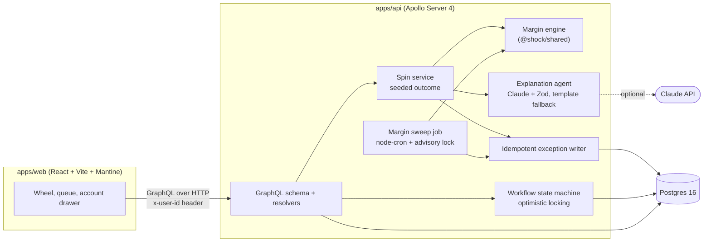

# Shock Wheel

Shock Wheel is an exception queue for a brokerage operations desk, with a twist. Spin the wheel and the server picks a market stress scenario, such as a Strait of Hormuz closure or a surprise 75bp Fed hike, at a random severity. It applies that shock to every seeded portfolio, writes an exception for each account that falls below maintenance margin, and asks an explanation agent to describe what happened: first-order price effects, second-order effects (including insurance and coverage angles), which accounts are at risk, and what the desk should do next. Analysts then work the queue: assign, escalate, resolve, with every step audited. A scheduled margin sweep runs alongside, catching breaches from ordinary price drift.

> Prices, positions and shock sizes are illustrative stress parameters, not forecasts or market data.

## Architecture



- **packages/shared**: types, the 8 wheel scenarios, the margin engine, and a seeded RNG. Pure functions, no I/O.
- **apps/api**: Prisma schema and seed data, the GraphQL API, the spin service, the sweep job, the explanation agent, and the workflow.
- **apps/web**: the UI. The server decides every spin result; the browser only animates the wheel to the slice the server returned.

## Quickstart

Needs Node 22+, pnpm 9 and Docker.

```bash
cp .env.example .env
cp .env.example apps/api/.env      # add ANTHROPIC_API_KEY here for Claude explanations

pnpm install
pnpm db:up                          # Postgres 16 in Docker
pnpm db:push                        # create the schema
pnpm db:seed                        # 16 accounts, 21 instruments, users

pnpm dev                            # API on http://localhost:4000, web on http://localhost:5173
```

Apollo Sandbox runs at http://localhost:4000. Switch users from the header; requests carry an `x-user-id` header (default `u-maya`).

Other useful commands:

```bash
pnpm test                           # all unit and integration tests
pnpm typecheck
pnpm --filter @shock/api sweep      # run one margin sweep from the CLI
pnpm --filter @shock/web build
```

## How idempotency works

Exceptions get written from two places, a scheduled sweep and user-triggered spins, and both can retry or overlap. Three mechanisms keep the queue free of duplicates.

1. **Unique `(accountId, dedupeKey)`.** Every exception carries a dedupe key: `sweep:<YYYY-MM-DD>` for the sweep and `run:<scenarioRunId>` for a spin. A unique constraint on `(accountId, dedupeKey)` means re-running the same sweep on the same day, or replaying the same run's write, can't create a second row. The writer skips rows it has already seen. If two writers race, the loser gets a unique violation (Prisma `P2002`), which is caught and counted as skipped.
2. **Postgres advisory lock for the sweep.** The sweep takes `pg_try_advisory_lock` before it starts. If another API instance already holds the lock, the sweep returns `skippedLocked: true` instead of waiting, so you can run several API instances without double sweeps.
3. **Seeded replay.** A spin's scenario, severity and price moves all derive from its seed. Passing the same seed to `spinWheel(seed:)` reproduces the run exactly: same slice, same breaches, same deficits. Runs are easy to audit and bugs are easy to reproduce.

Workflow changes (assign, escalate, resolve) use optimistic locking. The update is conditional on the status the server just read, so when two analysts act at once only one wins. The other gets a `CONFLICT` error, and the UI shows it and refreshes.

## Why the LLM only explains numbers

The margin engine computes every number: shocked prices, P&L, equity, requirements, deficits, breaches. The explanation agent runs after that, gets those results as input, and is told to use only the figures it was given and never invent prices, percentages or account numbers. Its response then has to pass two checks before the UI shows it:

1. **Schema.** Zod validates the JSON against a fixed shape.
2. **Numeric grounding.** Every number in every string Claude wrote is extracted (handling `$1,638.94`, `$1.6k`, `12M` and percentages) and compared against the numbers the engine supplied: deficits, equity before and after, P&L, sector shocks scaled by severity, the house margin bump, breach and account counts, plus numbers in the scenario's own text. Each of those is also accepted in common formatted variants: whole dollars, one-decimal thousands or millions, whole and one-decimal percentages. A match within 1% passes. Small integers (0–10) and account IDs such as `ACC-1004` are allowed. Any other number fails the check, the offending values are logged, and the API uses the template instead. The checker is `findUngroundedNumbers` in `apps/api/src/services/explainer.ts`, unit-tested without calling Claude.

There are three reasons for this split:

- **Correctness.** Margin calls move money. An LLM can phrase a deficit; it shouldn't calculate one.
- **Auditability.** Each exception is stored with numbers the engine produced, reproducible from the seed. The explanation adds context, not data.
- **Resilience.** The agent is never on the critical path. Without an `ANTHROPIC_API_KEY`, or if Claude times out, returns invalid JSON or quotes an ungrounded number, the API falls back to a deterministic template, and the UI tags each explanation as "Claude" or "Template".

## Tests

| Suite | Where | What it covers |
| --- | --- | --- |
| Margin engine (15) | `packages/shared/src/margin.test.ts` | Long and short margin math, shocks by sector, severity scaling, house bumps, breach and priority rules, seeded RNG determinism |
| API integration (13) | `apps/api/test/resolvers.test.ts` | Reproducible spins, one exception per breach, SPIN audit, sweep idempotency within a day and a fresh exception on a new day, assign → escalate → resolve with audit rows, resolved and conflict guards, concurrent resolves (only one wins), queue filters, before/after margin, queue stats |
| Explanation grounding (8) | `apps/api/test/explainer.test.ts` | Number parsing, a grounded response is accepted, an invented "$48,000 loss" falls back to the template, account IDs don't trip the check, severity-scaled percentages, the template's own output passes for every scenario and severity |
| Wheel math (4) | `apps/web/src/wheelMath.test.ts` | The wheel always lands the pointer on the server's slice, always spins forward 5–6 turns; label wrapping |

Integration tests run against a real Postgres database named `shock_test` (set `TEST_DATABASE_URL`). The test setup resets that schema on every run and refuses to touch any database whose name doesn't end in `_test`, so your dev data is safe. CI runs typecheck, all tests and the web build against a Postgres 16 service container.

## Next steps

- **DataLoader for N+1.** Field resolvers like `Exception.account`, `Exception.assignee` and `ScenarioRun.breachCount` each issue their own query. Batch them per request with DataLoader.
- **Real auth.** `x-user-id` is a demo stand-in. Replace it with OIDC/JWT sessions and role-based permissions (for example, only supervisors resolve escalations).
- **Subscriptions for live queue updates.** Push new exceptions and status changes over GraphQL subscriptions instead of refetching after each mutation, so every analyst's queue stays live.
- Generate web types with `@graphql-codegen` instead of the hand-written ones in `apps/web/src/graphql.ts`.
